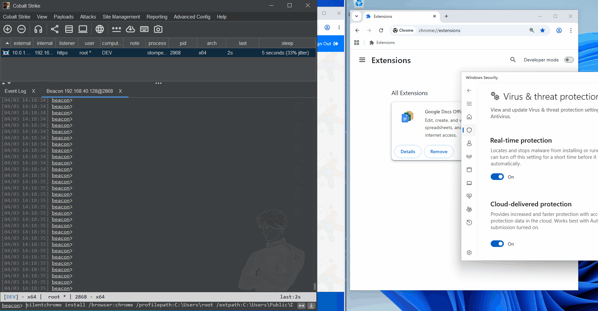

# SilentChrome-BOF



SilentChrome-BOF is a BOF (Beacon Object File) that silently installs a browser extension into Chrome or Edge by modifying the `Preferences` and `Secure Preferences` files directly. 

Port of [SharpSilentChrome](https://github.com/ChoiSG/SharpSilentChrome) from C# to BOF.

## Build

Requires `x86_64-w64-mingw32-gcc`

```
make          # release -> silentchrome.x64.o
make debug    # verbose output -> silentchrome-debug.x64.o
```

The CNA loads `silentchrome.x64.o` if it exists, otherwise falls back to `silentchrome-debug.x64.o`.

## Usage

Load `silentchrome.cna` in Cobalt Strike

```
beacon> help silentchrome
Usage:
  silentchrome install /browser:<chrome|msedge> /profilepath:<path> /extpath:<extension_path> [/sid:<SID>] [/force] [/backupext:<ext>]
  silentchrome revert /browser:<chrome|msedge> /profilepath:<path> /extpath:<extension_path> [/sid:<SID>] [/force] [/backupext:<ext>]

# Default profile (user home path)
silentchrome install /browser:chrome /profilepath:C:\Users\john /extpath:C:\ext
silentchrome install /browser:chrome /profilepath:C:\Users\john /extpath:C:\ext /force

# SYSTEM or another user context - specifying target user's SID 
silentchrome install /browser:chrome /profilepath:C:\Users\john /extpath:C:\ext /sid:S-1-5-21-... /force

# Reverting 
silentchrome revert /browser:chrome /profilepath:C:\Users\john /extpath:C:\ext /force

# Specific browser profile (exact profile directory)
silentchrome install /browser:msedge /profilepath:"C:\Users\john\AppData\Local\Microsoft\Edge\User Data\Profile 1" /extpath:C:\ext /force
silentchrome install /browser:chrome /profilepath:"C:\Users\john\AppData\Local\Google\Chrome\User Data\Default" /extpath:C:\ext /force
```

## Options

- `/browser` - `chrome` or `msedge`. (required)
- `/profilepath` - Either a user home directory (e.g. `C:\Users\john`) or an exact browser profile directory. See **Profile Path** below for more detail. (required)
- `/extpath` - Path to unpacked extension directory. (required)
- `/sid` - Target user SID. Auto-detected if omitted. Use this to target a different user's browser without `/force`. (optional)
- `/force` - Kill running browser, perform action, restart with `--restore-last-session`. Without this flag, the BOF aborts if the browser is running. (optional)
- `/backupext` - Backup file extension (default: `backupssc`). Must match between install and revert. (optional)

## Profile Path

The `/profilepath` option supports two modes:

**User home (default profile)** - If the path does not contain `\Default` or `\Profile`, it is treated as the user's home directory. The BOF appends the full browser-specific path automatically (e.g. `\AppData\Local\Google\Chrome\User Data\Default\`).

```
/profilepath:C:\Users\john
```

**Exact profile directory** - If the path contains `\Default` or `\Profile` (case-insensitive), it is used directly. The BOF looks for `Preferences` and `Secure Preferences` in that directory. Use this to target non-default profiles like `Profile 1`, `Profile 2`, etc. Quote the path if it contains spaces.

```
/profilepath:"C:\Users\john\AppData\Local\Microsoft\Edge\User Data\Profile 1"
/profilepath:"C:\Users\john\AppData\Local\Google\Chrome\User Data\Default"
```

## SYSTEM Context Warning

**Do not use `/force` from a SYSTEM context (e.g. after `getsystem`).** The browser will be killed but cannot be restarted under the target user's desktop session. Moreover, when the user restarts their browser, their session will not be restored which means availability issues. If you are `SYSTEM` context, `rev2self` or impersonate another user first, then use the BOF. 

## Revert & OPSEC

- Revert surgically removes the extension from the live preferences file rather than restoring backup snapshots. This prevents browser crashes caused by stale session state in old backups. Backup files are cleaned up after successful revert.

- The "developer mode extensions" warning popup is automatically suppressed by setting `dev_mode_warning_snooze_end_time` in the Preferences file. This is cleaned up on revert. Hardcoded value of `99999999998000000`. 

- Release build (`make`) strips verbose strings from the object file. Debug build (`make debug`) includes full diagnostic output.

- Without `/force`, the BOF only modifies files on disk. This is safe from any context (including SYSTEM with `/sid`). Attacker's extension will be loaded next time the user opens the browser.

- `/backupext` - The `Preferences` and `Secure Preferences` files will be backed up with the default extension of `.backupssc`. The backup files are not used for reverting, but used as a fallback/insurance of the original files in case something goes wrong. 

## Credits and References 

As mentioned in the [SharpSilentChrome](https://github.com/ChoiSG/SharpSilentChrome) repo, all credits goes to the original authors below. 

Original Research Paper: [https://www.cse.chalmers.se/~andrei/cans20.pdf](https://www.cse.chalmers.se/~andrei/cans20.pdf)

Nicholas Murray(Syntax-err0r)'s original blog post: [https://syntax-err0r.github.io/Silently_Install_Chrome_Extension.html](https://syntax-err0r.github.io/Silently_Install_Chrome_Extension.html) and [https://syntax-err0r.github.io/Return_Of_The_Extension.html](https://syntax-err0r.github.io/Return_Of_The_Extension.html)

AsaurusRex's blog post: [https://medium.com/@marcusthebrody/silently-install-chrome-extensions-macos-version-becf164679c2](https://medium.com/@marcusthebrody/silently-install-chrome-extensions-macos-version-becf164679c2) and [https://medium.com/@marcusthebrody/silently-install-macos-chrome-extensions-part-2-c9deab4216cd](https://medium.com/@marcusthebrody/silently-install-macos-chrome-extensions-part-2-c9deab4216cd)

AsaurusRex's python code: [https://github.com/asaurusrex/Silent_Chrome](https://github.com/asaurusrex/Silent_Chrome)

balu100's MSEdge Dev mode warning popup suppress trick: [https://github.com/balu100/chromium-developer-mode-warning-bypass](https://github.com/balu100/chromium-developer-mode-warning-bypass)